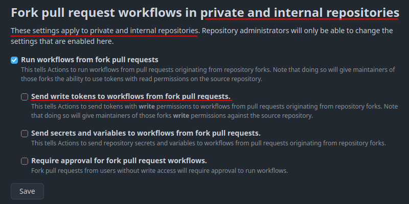

# Permissions

## Pull requests from Dependabot and forked repositories

Useful links and quotes from GitHub docs found during research.

> #### [Changing the permissions in a forked repository]
>
> You can use the `permissions` key to add and remove read permissions for forked repositories, but typically you can't grant write access. The exception to this behavior is where an admin user has selected the **Send write tokens to workflows from pull requests** option in the GitHub Actions settings. For more information, see [Managing GitHub Actions settings for a repository](https://docs.github.com/en/repositories/managing-your-repositorys-settings-and-features/enabling-features-for-your-repository/managing-github-actions-settings-for-a-repository#enabling-workflows-for-forks-of-private-repositories).

> #### [How permissions are calculated for a workflow job]
>
> The permissions for the `GITHUB_TOKEN` are initially set to the default setting for the enterprise, organization, or repository. If the default is set to the restricted permissions at any of these levels then this will apply to the relevant repositories. For example, if you choose the restricted default at the organization level then all repositories in that organization will use the restricted permissions as the default. The permissions are then adjusted based on any configuration within the workflow file, first at the workflow level and then at the job level. Finally, if the workflow was triggered by a pull request event other than `pull_request_target` from a forked repository, and the **Send write tokens to workflows from pull requests** setting is not selected, the permissions are adjusted to change any write permissions to read only.

The **Send write tokens to workflows from pull requests** and related settings are only applicable to private repositories [[1]]. See this screenshot of the [`wbstack` org actions settings](https://github.com/organizations/wbstack/settings/actions) (The **Run workflows from fork pull requests** is checked to show the other options; this is not enabled for the `wbstack` org):

Dependabot PRs are treated as if they are from a forked repo [[2]]:

> [!NOTE]
> Workflows triggered by Dependabot pull requests are treated as though they are from a forked repository, and are also subject to these restrictions.

Therefore, I don't think specifying fewer permissions for human PRs, increases the permissions for Dependabot PRs. We might want to investigate permissions further when we introduce renovate.

<!-- LINKS -->
[1]: https://docs.github.com/en/organizations/managing-organization-settings/disabling-or-limiting-github-actions-for-your-organization#enabling-workflows-for-private-repository-forks
[2]: https://docs.github.com/en/actions/reference/workflows-and-actions/events-that-trigger-workflows#pull-request-events-for-forked-repositories

[Changing the permissions in a forked repository]: https://docs.github.com/en/actions/reference/workflows-and-actions/workflow-syntax#changing-the-permissions-in-a-forked-repository
[How permissions are calculated for a workflow job]: https://docs.github.com/en/actions/reference/workflows-and-actions/workflow-syntax#how-permissions-are-calculated-for-a-workflow-job
